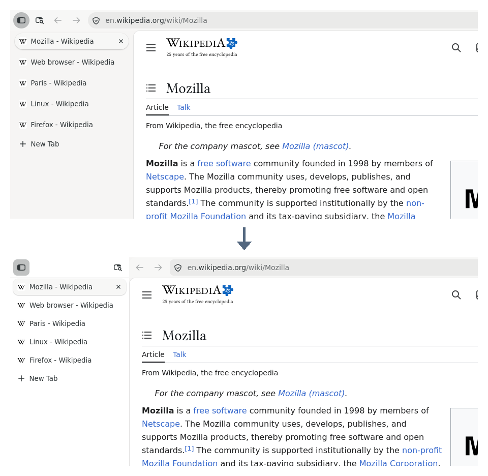
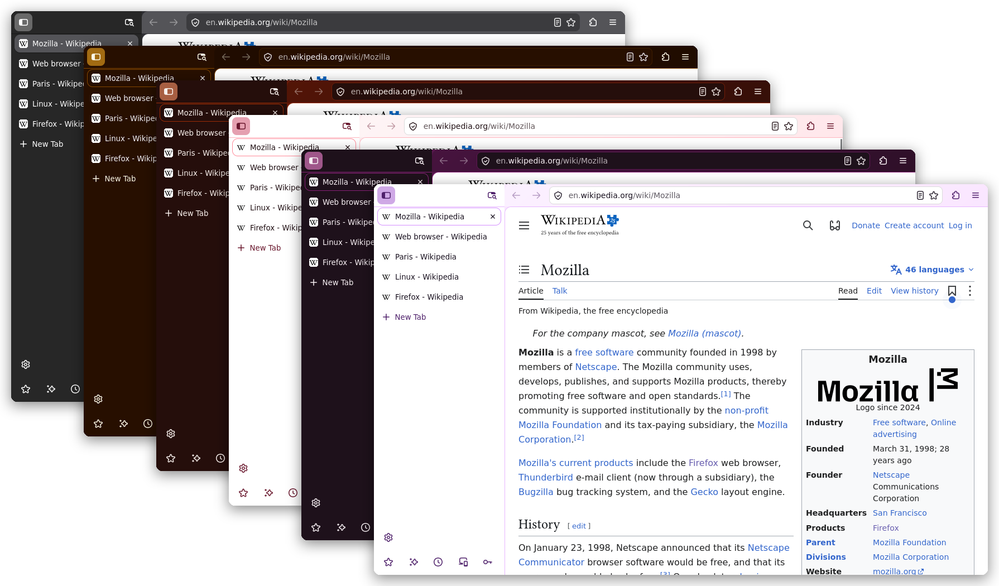

# Chrome-like layout for Firefox native vertical tabs



`chrome/userChrome.css` for Firefox 159 (tested on Ubuntu) with native vertical
tabs:

- the tabs panel reaches the top of the window;
- the navigation bar only takes the area to the right of the panel;
- when the menu bar is shown (via Alt or kept visible), it takes a
  full-width row above the tabs panel; when it is hidden, the layout is
  unchanged;
- tabs as rounded, spaced rows, pill-shaped "+" button;
- back / forward buttons keep Firefox's native icons, to stay consistent
  with the context menu shown by a right click on a page;
- empty area at the top of the panel (level with the navigation bar)
  that acts as a grip to move the window, with the native "collapse /
  expand sidebar" and "list / search tabs" buttons moved into this
  area, and a thin separator below it;
- panel background slightly distinct from the navigation bar (Firefox's
  native sidebar color, no imposed tint);
- in a narrow window, the address bar shrinks further so it never goes
  under the bar's native buttons or the window controls; Firefox moves
  the other buttons (VPN, account…) into the "»" overflow menu before
  the bar becomes too small, and the suggestions list keeps a readable
  width, centered under the bar;
- no imposed colors: the current Firefox theme is kept;
- address bar and buttons as rectangles with slightly rounded corners
  (instead of the native pills), whatever the tabs mode;
- in horizontal tabs mode, only this shape changes: the layout stays
  native.

The layout follows the active Firefox theme instead of imposing colors.
With the official Mozilla themes (Default, Sun, Spark, Flame, Flare,
Lavender, light and dark variants where available):



## Installation

Turn on vertical tabs in Firefox's settings first. The stylesheet lives in
`chrome/userChrome.css`, the layout the installers below expect. Pick one
way to install it, then fully restart Firefox.

### With fxcss

[fxcss](https://github.com/AdamXweb/fxcss) (Python 3.9+) installs into your
real profile, backs up your existing `chrome/` and can undo everything:

```bash
pipx install fxcss
fxcss install cjean-fr/firefox-chrome-look
```

To try the theme in a throwaway profile first, run
`fxcss try cjean-fr/firefox-chrome-look`. Remove it with `fxcss uninstall`.
fxcss lists a few "to check" items after installing; the only real
requirement is vertical tabs being on.

### With git-userChrome

[git-userChrome](https://github.com/soulhotel/git-userChrome) (needs `git`;
script or app) clones the repository into your profile's `chrome/` folder and
applies `chrome/user.js`, which enables the stylesheet preference:

```bash
bash <(curl -s https://raw.githubusercontent.com/soulhotel/git-userChrome/main/scripts/gituserChrome.sh) https://github.com/cjean-fr/firefox-chrome-look.git
```

It moves any existing `chrome/` to `chrome-<date>`. To remove the theme,
delete the profile's `chrome/` folder and move that backup back.

### By hand

1. Close Firefox. Find your profile directory in `about:support`, row
   "Profile Directory".
2. Copy `chrome/userChrome.css` into a `chrome/` folder inside that
   profile directory (create the folder if needed).
3. In `about:config`, set `toolkit.legacyUserProfileCustomizations.stylesheets`
   to `true` (or copy `chrome/user.js` into the profile directory).
4. Fully restart Firefox. To uninstall, delete `chrome/userChrome.css` from
   the profile and restart.

## Settings

The variables at the top of `userChrome.css` (`--fxc-*`) control tab
radius, height and spacing, and the height of the empty area at the top
of the panel. The tab height follows the native toolbar density (the
`--tab-min-height` variable: compact, normal or touch, and the font
size), and the empty area follows the navigation bar height of each
density; both can still be overridden with a fixed value.

## Known limitations

- The window grip uses the native `-moz-window-dragging` mechanism; it
  behaves like the empty area of a Firefox toolbar.
- The "collapse sidebar" and "list / search tabs" buttons only appear in
  the empty area if they are present in the navigation bar or the
  collapsed tabs bar (native buttons moved, not duplicates). In a very
  narrow window, Firefox may still move the "list / search tabs" button
  into the navigation bar's "»" overflow menu; it remains accessible
  there. The address bar's lower minimum (§9 of userChrome.css, applied
  only when one of these buttons is in the navigation bar) reduces how
  often this happens on common widths, but does not prevent it: with
  enough bar buttons, Firefox's native overflow always wins. This is
  native behavior that CSS cannot block.
- Back, forward, reload, extensions and the main menu never go into the
  "»" menu (Firefox choice): in a very narrow window, the address bar
  can only keep the room they leave.
- Opening the collapsed panel on hover (expand-on-hover) is not
  retested on every change; report it if an issue shows up.

## Development rules

- Rely on Firefox conventions (native attributes, variables and
  mechanisms), so that new versions are easy to follow.
- The committed version is our version, not a version to preserve.
- Firefox's behavior without a custom `userChrome.css` remains a useful
  baseline.

## License

MIT
